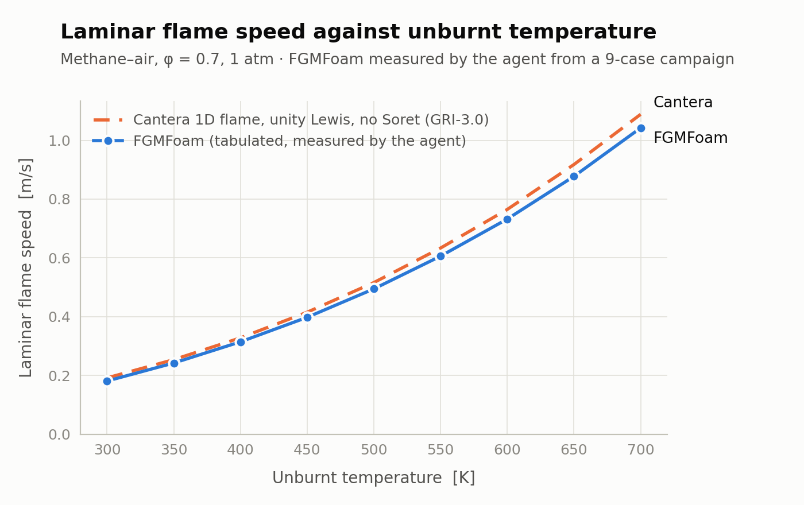
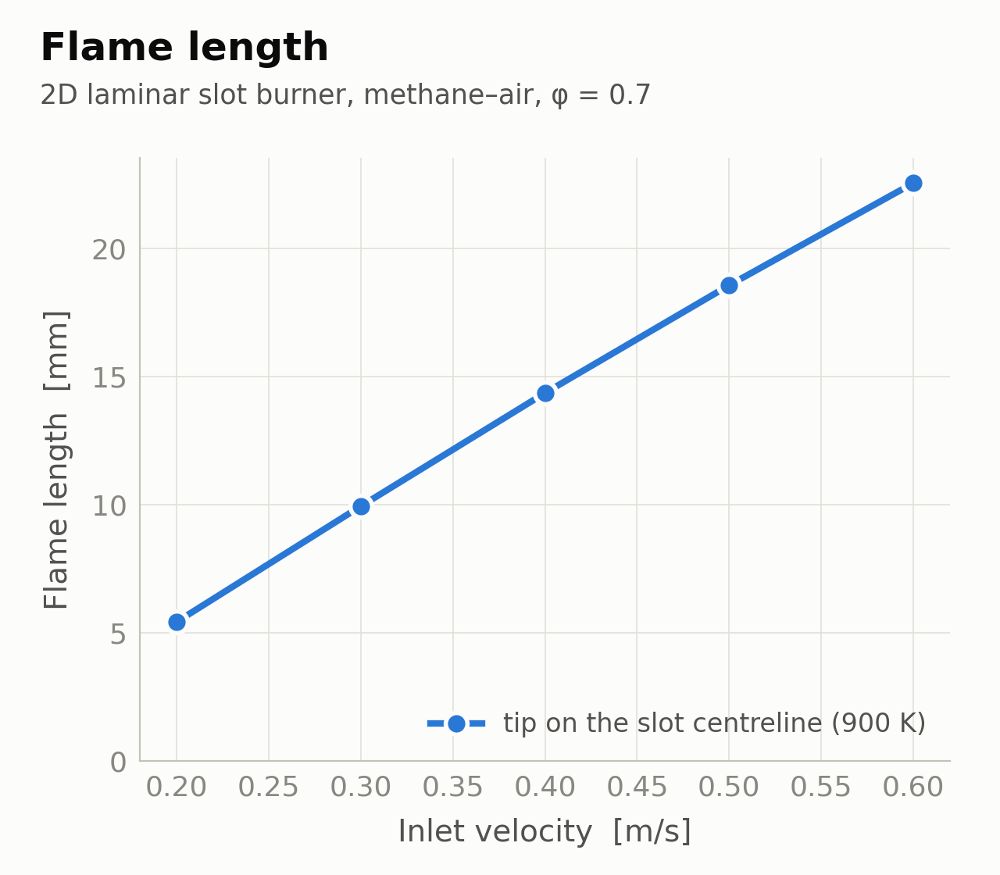

# FGMFoam Agent

A conversational, code-aware CLI assistant for the FGMFoam solver. In one chat
session it can:

- **Answer questions about the solver**: grounded in FGMFoam's own source and
  docs via a local retrieval index (RAG); for "how/why" questions it reads the
  actual source files and cites them.
- **Set up a test case**: the 2D laminar slot burner or the 1D freely
  propagating flamelet, from a plain-language description, deriving the
  thermochemistry with Cantera and writing a ready-to-run case (replacing the
  manual `sed` editing the bash `run` scripts did).
- **Run, monitor, stop, and delete** cases: a single run in the background, or a
  sweep of many with a core-aware concurrency limit.
- **Tweak and restart** a case: change the end time, time step, or number of
  snapshots in an already-built case (no rebuild), and continue a finished run
  from its latest saved time without re-meshing.

It runs on **the Mistral API (the default), the Claude API, the OpenAI API, or a
fully local open-source model** (Ollama/vLLM; nothing leaves the machine, which
matters for unpublished work). One word switches between them, mid-conversation if you like:
`/model claude`, `/model local-3b`, `/models` to see the list; see
[§2.1 Choosing a model](#21-choosing-a-model). Case building, validation and
running are plain Python and identical for every provider; the model only decides
*when* to call them.

```
> What is the progress variable definition?
  Yc = Y_CO2 / M_CO2: the CO2 mass fraction over its molar mass (kmol/kg), not a
  normalised 0–1 quantity. (agent/knowledge/solver_notes.md)

> Set up phi 0.7, U 0.2 m/s, inlet 300 K, plate 300 K, run 0.1 s, dt 1e-5 s
  Case written to testcases/laminarSlotBurner_agent/  (ready to run)
```

**Add your own case:** the two shipped cases are demonstrators. Any FGMFoam case
of yours can be managed by the agent by adding one folder with a short
declaration; see **[§5 Adding your own case](#5-adding-your-own-case)**.

**Contents:** [1. How the agent is built up](#1-how-the-agent-is-built-up) ·
[2. Installation](#2-installation) · [3. Make sure it works](#3-make-sure-it-works) ·
[4. Usage](#4-usage) · [5. Adding your own case](#5-adding-your-own-case) ·
[Known limitations and safety](#known-limitations-and-safety)

---

## 1. How the agent is built up

### Data flow (one chat turn)

```
 user message
      │
      ├─ embed query (FGM_EMBED_MODEL) ─▶ cosine top-k over the index ─▶ context
      │                                                                (chunks with path:line labels)
      ▼
 [ grounded system prompt + retrieved context + history + tool schemas ]
      │
      ▼  chat model (FGM_CHAT_MODEL: Mistral / Claude / OpenAI / local)
      ├─ grounded answer with citations            ─▶ shown to the user
      └─ tool call: build_case / run_case / run_cases / run_status / change_settings / restart_case / kill_jobs / delete_cases / read_case_file / compute_thermochemistry
             │
             ▼  Python executes (validator → Cantera → of_writer; runner for run_case)
             └─ result returned to the model ─▶ summary ─▶ shown to the user
```

All validation and file writing stay in Python; the model only decides *when* to
call a tool, so case building is deterministic and the required-parameter checks
cannot be bypassed.

### Source reads, diagnostics, and a reliability note

Answers are grounded two ways: retrieved chunks from the index, and, for
questions about how something works or is implemented, the agent reads the
**actual source files** with `read_case_file` before answering. Each turn prints
`·` diagnostic lines so you can see what the agent is doing: what it retrieved,
when it forces a source read, each tool call, and how long the turn took, e.g.:

```
· retrieved 6 context chunks (top: agent/knowledge/solver_notes.md:95-101, ...)
· implementation question -> forcing a source-file read
· read_case_file(path='solver/src/lookUp/FGM/FGMlib.c')
· answered in 12.4 s
```

(The timing is handy with local models, which are slower than the hosted API.)

> ⚠️ **Reliability warning.** If you ask for an explanation of how something works
> and you see **no `· read_case_file(...)` line**, the agent answered from
> retrieved fragments plus its own prior knowledge, and that output can be
> **unreliable** (it may invent formulas, key names, or steps that are not in the
> code). **Rephrasing with words like "explain", "describe", "tell me about",
> "how does … work", or "the … procedure" makes the agent open the relevant
> source file(s)** and answer from the real code. Watching for the file-access
> diagnostic is the quickest way to judge how grounded an answer is. (The
> diagnostics can be turned off with `FGM_SHOW_TOOLS=false`, but leaving them on
> is recommended for exactly this reason.)

### Guards: what the code enforces whatever the model does

A model only picks tools. These checks run in Python on every turn, for every
provider, and each one exists because a model (usually the local 3B) got it wrong
in testing:

| Situation | What the agent does |
|---|---|
| Build and run asked in one message | builds only; running is a separate request |
| "Is it possible to …?" | answers; builds, runs and deletes nothing |
| "…but do not start it" / "only prepare" | no run tool runs; a campaign is built with `launch=false` |
| The model picks a case type you never mentioned | it is sent back to ask which case you mean |
| You named the case ("laminar flamelet") but the model left `case_type` out | it is filled in from your message |
| You named what to sweep ("plate thickness", or values in K) but the model left `variable` out | it is filled in from your message; it is never guessed otherwise |
| A parameter value the tool cannot read (e.g. a list `[2, 3, 4]` for one case) | refused with the reason, never silently replaced by the default |
| The reply announces "I will call …" but makes no call | the model is asked once to make the call |
| The model fills in a required value you never gave (`T_plate=300`) | not built; it has to ask you |
| A length that is clearly in mm (`plate_thickness=5`) | converted if *you* wrote "5 mm" (or "2, 3 and 4 mm"); otherwise refused with "lengths are in metres" |
| A temperature outside 200–3000 K (`T_inlet=0.7`) | refused: a wrong unit, or a value meant for another parameter |
| A temperature the FGM table cannot hold (an unburnt gas at 3000 K, a plate at 2500 K) | refused at once, with the table's limits (unburnt gas 250 K to about 900 K, plate 250–2271 K for the shipped table); no other values are asked for first. Also for campaign values |
| You give a temperature in Celsius ("27 °C", "100 C", "300 degC") | read as kelvin before anything else ("300.15 K (27 °C)"), so tools and checks see kelvin |
| A velocity or dimension far outside its usual range (40 m/s, a 0.2 m slot) | nothing is built yet: the agent asks whether you are sure, and names the likely unit slip ("0.4 m/s if the value was in cm/s"). Only your confirmation, in your next message, lets it through |
| A slot at least as wide as the pitch (`hole_size >= hole_pitch`) | refused: there would be no plate left to mesh |
| "Now with a 5 mm plate" | the rebuild keeps your other settings (`inherited` in the provenance) |
| You state a value with its name and unit ("a plate thickness of 5 mm", "hole size 6 mm") but the model's call drops or mangles it | the call carries your value (read from your message, unit-checked) |
| You answer the "how should I split the cores?" question, but the model makes no call | the campaign it asked about is completed with your plan (still `launch=false` if you said not to start) |
| `check_case` / `run_case` etc. without a name | the case built last in this conversation |
| The reply says "built" or "running" but no tool did that | the model is asked once to actually do it; if it still doesn't, a correction is appended |
| You give "450 K" or "6 mm" but no tool call used that value | the model is asked once to apply it; if it still doesn't, the reply says the value was not applied |
| Geometry or conditions sent to `change_settings` | the case is rebuilt with them instead of the value being silently ignored |
| The prompt would not fit a local model's context | file reads become excerpts (around the retrieved lines, or the part densest in your question's words); the oldest turns are dropped |

They show up as `·` diagnostic lines (`· skipped run_cases (the user said not to start it)`).

### Files

| File | Responsibility |
|------|----------------|
| `main.py` | Conversational entry point. Loads config, auto-builds the index on first run, then runs the chat REPL (or a one-shot prompt), rendering the agent's markdown replies with `rich`, the `·` activity diagnostics (retrieval, forced reads, tool calls like `· read_case_file(...)`), and a per-answer timing line. |
| `chat.py` | `ChatAgent`: per turn, retrieves context from the index, builds a grounded system prompt, and runs the tool-calling loop against whichever provider is active. |
| `tools.py` | The function-calling tools: `build_case`, `run_case`, `run_cases` (core-aware batch), `run_status`, `change_settings` (edit controlDict in place), `restart_case` (continue from the latest time), `kill_jobs` (stop/cancel runs), `delete_cases` (remove generated cases), `read_case_file` (verbatim file contents), `check_case` (the pre-run gate, read-only), `analyse_run` (post-run interpretation), `run_campaign` / `analyse_campaign` (sweeps), `switch_model` (change the answering model mid-conversation; executed by `chat.py`, not the stateless tool layer), and `compute_thermochemistry`, wrapping the deterministic pipeline. Errors are returned to the model, not raised. |
| `llm.py` | The provider adapters (Mistral, Claude and OpenAI-compatible) behind one interface. Chat requests are written once in the OpenAI shape; the Claude adapter translates them to and from the Anthropic Messages API (separate `system`, tool schemas under `input_schema`, content blocks instead of `tool_calls`) so the rest of the agent is provider-agnostic. |
| `config.py` | Configuration source of truth: resolves the preset, provider, models, API keys and tunables, and keeps the embedding side independent of the chat side. |
| `validator.py` | Single source of truth for the case parameters: names, types, units, defaults, required set, plus type coercion and default-filling. |
| `cantera_tool.py` | Cantera thermochemistry: the progress-variable bounds and the unburnt enthalpy. |
| `of_writer.py` | Builds a clean, named copy of the template case (with an empty `foam.foam`) and substitutes every placeholder with `str.replace`; also edits run-control keys in an existing case's `system/controlDict` in place (`change_settings`). Never modifies the original template. |
| `runner.py` | Runs the solver pipeline (blockMesh → setFields → decomposePar → FGMFoam → reconstructPar) for a built case, logging each step; plans and launches restarts from the latest saved time; also detects physical cores and plans batches. |
| `run_batch.py` | Detached orchestrator that runs several cases with bounded concurrency (launched by `run_cases`). |
| `rag/corpus.py` | Collects the knowledge corpus: solver C++ source (`.C`/`.H` and lowercase `.c`/`.h`), docs, the `knowledge/` notes, the example case dictionaries, and the FGM table header. |
| `rag/chunker.py` | Splits corpus files into citable chunks (`path:start-end`). |
| `rag/embeddings.py` | Embedding wrapper (batching + retry) over the configured embedding provider. |
| `rag/index.py` | Builds / saves / loads / cosine-searches the local vector index. |
| `index_build.py` | CLI to build or rebuild the knowledge index. |
| `knowledge/*.md` | Curated domain facts not stated in the code; indexed into the knowledge base. |
| `campaign.py` | Campaigns (one variable swept over several values): what may be swept, how the machine is shared between cases, the results table and the graph. |
| `timestep.py` | Chooses the fixed time step from the mesh and the flow (`dt = CFL x dx / U`), before the run: the solver cannot adapt it. |
| `postrun.py` | Post-run interpretation: solver health from `log.FGMFoam`, and the flame measurement for each case type (flame speed; flame length / flashback / blow-off). Field data comes from OpenFOAM's own `postProcess` line sampling. |
| `of_mesh.py` | Mesh bounding box, smallest cell spacing and cell count from `constant/polyMesh`. Shared by the pre-run checks and the sampling line. |
| `precheck.py` | The pre-run sanity gate: conditions inside the FGM table, an estimated Courant number from the real mesh, decomposition and write-interval sanity. Pure Python, no model involved. |
| `provenance.py` | Writes `agent-provenance.json` into every generated case: the parameters and **which of them the user chose**, the thermochemistry and its mechanism, the FGM table's content hash, the agent version/commit, and the model that routed the request. Never allowed to fail a build. |
| `fgm_table.py` | Read-only Python counterpart to `FGMlib.c`: an FGM table's header, content hash and control-variable ranges, cached per file. |
| `cases/<name>/case.py` | **One folder per simulation case**: the case's parameters, placeholders, what can be swept, its time-step velocity scale and its measurement. Auto-discovered; see [§5 Adding your own case](#5-adding-your-own-case). |
| `case_api.py` | The plugin API a case imports: `CaseTemplate`, `ParamSpec`, the common parameters. |
| `measures.py` | Ready-made post-run measurements a case can declare (front speed, front behind a body, crossing position, field extremum). |
| `case_templates.py` | The registry over the discovered cases, queried by the rest of the agent. |
| `providers.py` | The model presets: the friendly names (`claude`, `local-3b`) that expand into a full provider configuration, and the `/models` listing. |
| `tests/` | Offline tests for the provider translation layer and preset resolution (no API key, no network). |
| `.env.example` | Template for the optional `agent/.env` configuration file. |
| `requirements.txt` | Python dependencies. |

### Case templates (`agent/cases/`)

Two template cases can be set up, chosen with the `case_type` argument (or in
conversation: *"set up a flamelet case ..."*). `/cases` lists them in the REPL.

| `case_type` | What it is | You must give | Recommended run controls (at 300 K) |
|-------------|------------|---------------|-------------------------------------|
| `laminarSlotBurner` | 2D premixed jet between cooled plates: a steady Bunsen-type flame | `inlet_velocity`, `T_inlet`, `T_plate` | `sim_time` 0.1 s, `sim_timestep` 1e-5 s |

The slot burner's **geometry is parameterised too**, so the burner shape can be
varied as well as the conditions; see below. The flamelet's mesh is not.
| `laminarFlamelet` | 1D freely propagating flame: a quiescent premixed mixture ignited in a box region | `T_inlet` | `sim_time` 0.1 s, `sim_timestep` 2e-6 s |

The recommended run controls are the values each case's own `run` script ships
with (the settings it was developed and tested at), so "set up a flamelet at
300 K" is a complete request. A test asserts they stay in step with those
scripts. When the agent falls back to them it says so, rather than presenting
them as your choice.

Only the **conditions** differ between generated cases. The mesh
(`blockMeshDict`), the boundary-condition *types*, and the numerical schemes are
copied from the template unchanged: the agent never alters geometry.

**The case type is never guessed.** If a request does not make it clear which
case is wanted ("set up a case at 300 K for 0.1 s"), `build_case` returns a
`missing_case_type` result and the agent asks, exactly as it does for a missing
parameter: building the wrong geometry silently is worse than one extra
question. It only skips the question when the supplied parameters can mean just
one case: an `inlet_velocity` or a `T_plate` implies the slot burner, since a
flamelet has neither. Naming the case (`case_type`, or just saying "a flamelet
case") always wins over that inference. Like the required-parameter check, this
is enforced in Python, so it holds whichever model is answering.

The flamelet has no inlet and no walls (every patch is `zeroGradient` or
`empty`, and the flame is started by the `setFields` ignition box), so
`inlet_velocity` and `T_plate` do not apply there: they are neither asked for nor
written. `T_inlet` is the unburnt-mixture temperature in both cases; for the
flamelet the aliases `T_initial`, `T_unburnt` and `T_0` are accepted too, since
"initial temperature" is the natural phrasing for a quiescent mixture.

The two shipped cases are demonstrators. Each is declared as a plugin under
`agent/cases/`, and your own simulations are added the same way; see
[§5 Adding your own case](#5-adding-your-own-case).

See [§5 Adding your own case](#5-adding-your-own-case).

### Choosing the time step (`timestep.py`)

The solver runs at a **fixed** time step: `controlDict` has `adjustTimeStep no`,
and its `maxCo` entry is inert. Nothing throttles the step at run time, so one
that is too large does not self-correct: it diverges. The step therefore has to
be right before the run starts, and `build_case` computes it whenever you do not
give one:

```
dt = CFL x dx / U          CFL = 0.1
```

The velocity is **not** the inlet velocity. Gas leaves a flame about
`rho_u/rho_b` times faster than it enters (roughly 6x for methane–air at
φ = 0.7), and that burnt-gas velocity is what sets the Courant number. Which
velocity applies depends on the case:

| Case | `dx` | `U` | Cost |
|------|------|-----|------|
| `laminarSlotBurner` | `flame_thickness / 10`, the real cell size | `inlet_velocity × ρ_u/ρ_b` | free: the density ratio already comes from the equilibrium calculation |
| `laminarFlamelet` | 10 µm, fixed by its `blockMeshDict` | `S_L × ρ_u/ρ_b`: nothing but the flame moves the gas | a 1D free-flame solve, ~10–20 s, cached on disk |

The result is rounded to one significant figure and then shrunk so it divides
the write interval exactly, otherwise the solver lands on 0.019998 instead of
0.02 and the snapshots drift.

**Checked against real runs.** For the slot burner at the shipped conditions the
formula gives 5.07e-6 s; a run at 5e-6 s held a settled Courant of **0.11**
against the 0.1 target. For the flamelet at 2e-6 s it predicts 0.21 and the run
held **0.19**.

The estimate is reported as `sim_timestep_estimated` with its full derivation,
and the provenance record marks the parameter `estimated` rather than
`recommended`. Give `sim_timestep` explicitly and none of this runs.

When no estimate is possible (a missing velocity, or a free-flame solve that
does not converge), the case falls back to its shipped step, and *then* the older
rule of thumb applies: a hotter mixture burns faster and thinner, so the step is
scaled by (300 K / T)² and reported as a `timestep_warning`.

### Courant number: start-up versus settled

Both cases are ignited as a step function, which is a discontinuity rather than
a flame, and relaxing it spikes the Courant number for a few steps. Judging a run
on that peak condemns perfectly good simulations: a slot burner that sat at 0.11
for 6000 steps reported a maximum of **4.11**, entirely from step 3.

`analyse_run` therefore reports `courant_max` *and* `courant_max_settled` (the
maximum after the first 20 steps), and only calls a run into question when the
**settled** value exceeds 1. A high peak alone is noted as expected start-up
behaviour.

### Case parameters

`validator.py` defines the parameters of the `build_case` tool. The model
collects the required ones through conversation (asking for any it is still
missing) before building; optional ones fall back to the listed default. Which
parameters are *required* is decided per template by the table above, in Python
rather than in the JSON schema.

| Parameter | Type | Required | Default | Unit | Meaning |
|-----------|------|----------|---------|------|---------|
| `equivalence_ratio` | float | no | 0.7 | – | equivalence ratio (φ), fixed at 0.7 by the current FGM table |
| `inlet_velocity` | float | slot burner | none | m/s | inlet bulk velocity |
| `T_inlet` | float | yes | none | K | unburnt-gas temperature (`T_0` in the original run scripts) |
| `T_plate` | float | slot burner | none | K | plate wall temperature |
| `sim_time` | float | no | 0.1 | s | total simulated time (`endTime`) |
| `sim_timestep` | float | no | 1e-5 / 2e-6 | s | fixed solver time step (`deltaT`); per case, see above |
| `n_procs` | int | no | 4 | – | MPI processes / mesh subdomains |
| `sim_write_steps` | int | no | 100 | – | number of write snapshots |
| `n_steps` | int | no | – | – | run this many time steps instead of giving `sim_time`: `sim_time = n_steps × sim_timestep`, computed per case once the time step is known (so a campaign gets the same number of steps in every case); not together with `sim_time` or `flow_throughs` |
| `p_0` | float | no | 101325 | Pa | operating/initial pressure |
| `plate_thickness` | float | no | 3.1139e-3 | m | streamwise thickness of the plate (slot burner) |
| `hole_pitch` | float | no | 1.24556e-2 | m | centre-to-centre distance between slots (slot burner) |
| `hole_size` | float | no | 7.47336e-3 | m | open height of the slot (slot burner) |
| `outlet_length` | float | no | 1.86834e-2 | m | domain length downstream of the plate; must contain the flame tip (slot burner) |
| `flame_thickness` | float | no | 6.2278e-4 | m | sets the cell size `dx = lF/10` only (slot burner) |

The **equivalence ratio (φ=0.7) and pressure (101325 Pa) are baked into the FGM
table**, not free dimensions of it. The agent uses those defaults, and
`build_case` rejects a different φ or pressure (the table would need regenerating
at the new value).

### Derived thermochemistry (`cantera_tool.py`)

Computed (by the `compute_thermochemistry` tool and during `build_case`) from
`equivalence_ratio`, `T_inlet`, and `p_0` using:

- mechanism `gri30.yaml`,
- `gas.set_equivalence_ratio(phi, fuel="CH4", oxidizer="O2:1, N2:3.76")`.

| Quantity | Definition | Unit |
|----------|------------|------|
| `Yc_u` | progress variable of the fresh mixture, `Y_CO2 / M_CO2` | kmol/kg |
| `Yc_b` | progress variable at chemical equilibrium (`gas.equilibrate("HP")`), `Y_CO2 / M_CO2` | kmol/kg |
| `ht` | specific enthalpy of the unburnt mixture | J/kg |

`Y_CO2` is the CO2 mass fraction and `M_CO2` its molar mass (from
`gas.molecular_weights`, kg/kmol), so `Yc` is a specific mole number. For φ=0.7,
T=300 K this yields `Yc_u = 0`, `Yc_b ≈ 2.445e-3`, `ht ≈ -1.807e5 J/kg`.

### Burner geometry (slot burner only)

`testcases/laminarSlotBurner/system.orig/blockMeshDict` is parameterised, so a
case can change the burner shape and not just the flow conditions. Each case
gets its own mesh, built by `blockMesh` as usual.

| Parameter | Sets | Default |
|-----------|------|---------|
| `plate_thickness` | `l_plate`: streamwise thickness of the flame holder | 3.1139 mm |
| `hole_pitch` | `h = pitch/2`: the domain is one half-slot | 12.4556 mm |
| `hole_size` | `h_plate = h − size/2`: the open slot height | 7.47336 mm |
| `outlet_length` | `l_out`: domain length downstream of the plate | 18.6834 mm |
| `flame_thickness` | `lF`, which sets `dx = lF/10` and nothing else | 0.62278 mm |

The domain is one half-slot: symmetric about `y = 0` (the wake centreline behind
the plate) and about `y = h` (the slot centreline, where the flame closes and its
length is measured). `flame_thickness` is deliberately decoupled from the
geometry: it refines the mesh without moving anything, so resolution and shape
are independent knobs.

**`outlet_length` must contain the flame.** The flame length grows with the inlet
velocity (about 4.5 mm per 0.1 m/s at the defaults), and with the default outlet
the tip reaches the outlet at about 0.45 m/s. Longer flames need a longer outlet;
the analysis reports `longer_than_domain` rather than a number when the tip is at
or past the outlet. A longer outlet means more cells and, with `flow_throughs`,
a longer `sim_time`.

**The defaults reproduce the original mesh exactly.** Before parameterisation the
dictionary hardcoded `l_plate = 5 lF`, `h = 10 lF`, `h_plate = 4 lF`,
`l_out = 30 lF` and `dx = lF/10`; the defaults above are those same values, and a
default build still produces the same 43 000-cell mesh. A test asserts the
relationships, so the shipped case cannot drift. The bash `run` script sets the
same values at the top, so the case remains usable without the agent.

Changing geometry changes the mesh, and the flame-length measurement follows
automatically: the flame holder is located from the **gap in the sampled axis
points**, so a thicker plate is found without being told. Verified: with the
plate thickness doubled the analysis reports the holder at 6.18 → 12.48 mm
instead of 6.18 → 9.36 mm.

### Placeholder substitution (`of_writer.py`)

`build_case` copies the chosen template to `testcases/<case_type>_<descriptor>/`
(default `<case_type>_agent`, deleting and recreating it if present), installs
`tables/database.fgm` into `constant/lookUp/`, materialises the working `0/` and
`system/` folders from their `.orig` templates, and replaces these tokens:

| Placeholder | Replaced with | File(s) | Templates |
|-------------|---------------|---------|-----------|
| `INITIALPROGRESSVARIABLE` | `Yc_u` | `0/Yc`, `system/setFieldsDict` | both |
| `FINALPROGRESSVARIABLE` | `Yc_b` | `system/setFieldsDict` | both |
| `INITIALENTHALPY` | `ht` | `0/ht` | both |
| `INITIALPRESSURE` | `p_0` | `0/p` | both |
| `SIMULATIONTIME` | `sim_time` | `system/controlDict` | both |
| `SIMULATIONDELTATIME` | `sim_timestep` | `system/controlDict` | both |
| `SIMULATIONWRITETIME` | `sim_time / sim_write_steps` | `system/controlDict` | both |
| `NPROCS` | `n_procs` | `system/decomposeParDict` | both |
| `INLETTEMPERATURE` | `T_inlet` | `0/T` | slot burner |
| `PLATETEMPERATURE` | `T_plate` | `0/T` | slot burner |
| `INLETVELOCITY` | `inlet_velocity` | `0/U` | slot burner |
| `INITIALTEMPERATURE` | `T_inlet` | `0/T` | flamelet |
| `FLAMETHICKNESS` | `flame_thickness` | `system/blockMeshDict` | slot burner |
| `PLATETHICKNESS` | `plate_thickness` | `system/blockMeshDict` | slot burner |
| `HOLEPITCH` | `hole_pitch` | `system/blockMeshDict` | slot burner |
| `HOLESIZE` | `hole_size` | `system/blockMeshDict` | slot burner |
| `OUTLETLENGTH` | `outlet_length` | `system/blockMeshDict` | slot burner |

A test asserts that every uppercase token actually present in the template case
files has a declared replacement, so a case file cannot gain a placeholder that
silently survives into a built case.

The original templates under `testcases/laminarSlotBurner/` and
`testcases/laminarFlamelet/`, the `solver/` directory, and `tables/` are never
modified: the agent always works on a copy, and `delete_cases` refuses any name
that is not a generated, prefixed case.

### Campaigns: sweeping one variable (`campaign.py`)

A campaign is the unit of actual research use (*"flame speed against unburnt
temperature"*, *"flame length against plate temperature"*) rather than a single
case. `run_campaign` builds one case per value, runs them, and
`analyse_campaign` collects the results into `results.csv` and a graph.

```
> Run flamelets at 300, 400, 500 and 600 K

  That's 4 cases and this machine has 8 physical cores. How should I spend them?
    · 8 cores per case, 1 at a time (fully sequential)   (4 waves)
    · 4 cores per case, 2 at a time                      (2 waves)
    · 2 cores per case, 4 at a time                      (1 wave)
    · 1 core per case,  4 at a time (each case serial)   (1 wave)

> 2 cores each, all four at once
  ... 4 cases launched, 8 of 8 cores in use.

> Show me the results
  agent/campaigns/Tsweep/results.csv  and  Tsweep.png
```

**The CPU plan is always the user's decision.** How to spend the machine changes
wall-clock time by a large factor and depends on what else is running, so
`run_campaign` called without `n_procs_per_case` / `n_concurrent_cases` returns
the detected core count and the sensible splits and refuses to start. Every
option keeps `procs × concurrent ≤ physical cores`: oversubscribing physical
cores makes a CFD run slower, not faster, and a plan that exceeds them is
rejected with the arithmetic.

**What can be swept**, enforced in code rather than in the prompt:

| Case | Sweepable |
|------|-----------|
| `laminarFlamelet` | `T_inlet` |
| `laminarSlotBurner` | `T_inlet`, `T_plate`, `inlet_velocity`, **`plate_thickness`, `hole_pitch`, `hole_size`, `outlet_length`, `flame_thickness`** |

The slot burner's geometry is sweepable because its `blockMeshDict` is
parameterised (see [Burner geometry](#burner-geometry-slot-burner-only)); each
case in such a sweep gets its own mesh. Two things are still refused, with the
reason rather than a bare "unsupported":

- **Equivalence ratio and pressure**: both are baked into the FGM table, so a
  sweep needs one regenerated table per value, not a different case.
- **Geometry the template does not expose**, and any geometry on the flamelet,
  whose mesh is not parameterised. The message names the parameters that do
  exist rather than just refusing.

**The graph** plots the measurement against the swept variable: flame speed for
the flamelet, flame length for the slot burner. Cases that flashed back or blew
off are not silently dropped: they stay in the CSV as outcomes and are marked
on the graph with a vertical line, because *"the flame blows off above this
velocity"* is a result. Plotting needs matplotlib; without it the CSV is still
written and the graph is reported as skipped.

**Run length per case.** With `flow_throughs=N`, each slot-burner case runs for
N flow-through times of *its own* conditions (domain length / inlet velocity)
instead of one shared `sim_time`, which would over-run the fast cases and
under-run the slow ones when inlet velocity or plate thickness is swept. Note
that the number of steps per flow-through does not depend on the inlet velocity:
a faster inlet shortens the pass but forces a proportionally smaller time step.

**Fixed geometry.** Geometry the sweep does not vary can still be set once for
every case, e.g. `outlet_length=0.035` for a velocity sweep whose fast flames
outgrow the default domain. The flow-through time follows the longer domain.

**Prepare now, start later.** `launch=false` builds every case and saves the
campaign, CPU plan included, without starting anything: *"set it up but wait
for my go"*. `start_campaign` launches it later and re-checks the plan against
the cores available at that moment. It counts as a run step, so it never fires in
the same turn as a build.

**Example.** A nine-case flamelet campaign, 300–700 K, run with the automatic
time step (settled Courant 0.12–0.16 against the 0.1 target):



The measured speeds are clean (every fit has R² ≥ 0.9996 and the unburnt gas is
at rest), and they follow the expected trend, S_L ∝ T_u^2.1. The reference is a
Cantera 1D free flame with the **same transport assumptions as the FGM model**:
unity Lewis number, no thermal diffusion (Soret). FGMFoam sits a steady ~4 %
below it across the whole range (4.1–5.5 %). An earlier comparison against
Cantera's default mixture-averaged transport showed a gap growing from 8 % to
20 % with preheat; that was differential diffusion in the reference, which the
unity-Lewis model deliberately omits, not a fault in the table. Data:
`docs/examples/laminar_flame_speed.csv`; regenerate with
`docs/examples/make_figures.py`.

A five-case slot-burner campaign, inlet velocity 0.2–0.6 m/s at 300 K, two
flow-through times each, `outlet_length = 0.035` m, 2 cases × 4 cores at a
time (about 8 hours in all):



The length grows almost linearly, from 5.4 mm at 0.2 m/s to 22.5 mm at
0.6 m/s (about 4.3 mm per 0.1 m/s, flattening slightly at the high end), the
expected behaviour of a premixed Bunsen-type flame whose cone lengthens as the
inflow outruns the flame speed. The tips are converged: they moved by less
than 0.003 mm over the last quarter of each run (settled Courant 0.18–0.31).
The longer outlet matters: with the default one (about 18.7 mm behind the
plate) the tip at 0.5 and 0.6 m/s reaches the outlet and the agent reports
`longer_than_domain` with a lower bound instead of a number. Where both
domains hold the flame (0.2–0.4 m/s) the lengths agree within 0.01 mm. Data:
`docs/examples/flame_length_vs_inlet_velocity.csv`.

Output lives in `agent/campaigns/<name>/` (git-ignored): `campaign.json` (the
sweep and the CPU plan used), `results.csv`, and `<name>.png`.

### After the run: what actually happened (`postrun.py`)

`analyse_run` closes the loop. It reports two things, both measured rather than
inferred by the model.

**How the solver behaved**, from `log.FGMFoam`: the Courant number actually
reached (the pre-run gate only *estimates* one), simulated time, execution time,
the cumulative continuity error, and whether the run hit a fatal error or
produced non-finite values. A Courant number above 1 is called out explicitly:
the step is fixed, so the solver could not have reduced it.

**What the flame did**, per case type:

| Case | Measurement |
|------|-------------|
| `laminarFlamelet` | the **laminar flame speed** |
| `laminarSlotBurner` | the **flame length**, or **flashback** / **blow-off** / **longer than the domain** |

*Flame speed.* The front is tracked over the written times as the position where
the temperature crosses the threshold, and its speed taken **relative to the
unburnt gas**: the burnt gas expands and pushes the fresh mixture towards the
open end, so the lab-frame front speed overstates the flame speed by that
velocity. The case is ignited as a **step function** in the progress variable,
which is a discontinuity rather than a flame, so the initial relaxation is
excluded: a fixed fraction of the run is discarded as a floor, then the longest
trailing window whose scatter is within 5 % is used. The window, the transient
that was dropped, and the fit R² are all reported, and a poor fit is flagged
rather than averaged over.

*Flame length.* The flame anchors on the plate and closes on the **slot
centreline** (`y = h`) downstream of it; the length is the distance from the
plate's **trailing edge** to the first point on the slot centreline reaching the
threshold. Two lines are sampled, along both symmetry planes: the plate is
located from the **gap it leaves in the wake line** (`y = 0`). It is a solid, so
no cells exist under it, which means no `blockMeshDict` is parsed here either,
and the tip is read on the slot centreline. The tip must not be read from the
wake: that fills with burnt gas just behind the plate at any velocity, which
once gave ~0.5 mm for every case of a velocity sweep. Three outcomes make the
number meaningless and are reported instead of it:

- **flashback**: the gas is above the threshold *upstream* of the plate, so the
  flame has propagated into the inlet channel;
- **blow-off**: nothing downstream reaches the threshold, so no flame is
  anchored;
- **longer than the domain** (`longer_than_domain`): the wake is burnt but the
  slot centreline stays cold up to the outlet, or the tip is within 5 % of it:
  the flame is anchored, but the domain sets the number. The outlet distance is
  reported as `flame_length_lower_bound`; rebuild with a larger `outlet_length`.

**The threshold** defaults to 900 K (`temperature_threshold`). Methane's
autoignition temperature is about 810 K (537 °C), so 900 K sits just above it:
comfortably inside the reaction zone and far from both the unburnt (300 K) and
burnt (~1840 K at φ = 0.7) states, which makes the crossing sharp and
insensitive to the exact value. What matters when comparing cases is using the
same threshold throughout.

Sampling runs OpenFOAM's `postProcess -func`, so it needs an OpenFOAM-sourced
shell; without one, `analyse_run` still reports the log and says why sampling was
skipped. It writes a `system/agentAxisSample` dict and a `postProcessing/`
directory into the case, both safe to delete.

### Pre-run checks (`precheck.py`)

A parallel FGMFoam run can occupy a machine for hours. Several ways of wasting
that time are detectable in milliseconds beforehand, so `run_case` checks the
case between the setup steps and the solver (`blockMesh` takes seconds, the
solver does not) and **refuses to launch if anything is an error**:

| Check | Severity | Why |
|-------|----------|-----|
| Operating pressure matches the table's `[PRESSURE]` | error | every thermochemical quantity comes from that table |
| Initial enthalpy inside the tabulated `CV2` range | error | outside it there is nothing to look up |
| Progress-variable values inside the `CV1` range | error | the burnt value must be the table's own equilibrium |
| Enthalpy within 2 % of the range edge | warning | heat loss during the run may push it outside |
| Estimated Courant number from the real mesh | warning | the step is fixed, so a large one diverges rather than adapting |
| Cells per MPI rank | warning | below ~1000, communication costs more than the ranks gain |
| `writeInterval` below `deltaT` | warning | output every step, or none |
| Implausible step count | warning | almost always a ms/s units slip |
| `endTime` shorter than one flow-through time | warning | the fresh gas has not crossed the domain, so the result still reflects the initial condition |
| Fewer than 3 flow-through times | info | a steady flame is usually converged after about three; check the flame length has stopped changing |

Errors block the run and are reported with a `blocked` status; warnings are
passed on and the run proceeds. To run anyway, `skip_checks=true` (the agent will
only do that if you ask after seeing the errors). `check_case` runs the same
checks read-only at any time: *"does this case look right?"*

The Courant estimate uses the **smallest actual cell spacing**, read from
`constant/polyMesh/points` after the mesh is built. That matters because both
shipped meshes are strongly graded towards the flame, so an average spacing would
flatter the result. When the velocity field starts at rest (the flamelet), the
convective velocity is set by the propagating flame rather than the initial
condition, and the gate says so instead of reporting a meaningless `Co = 0`.

The **flow-through time** is the axial domain length over the inlet velocity:
28 mm / 0.2 m/s ≈ 0.14 s for the shipped slot burner. It is deliberately
conservative (the burnt gas downstream moves faster than the inlet gas), and it
does not apply to the flamelet, which starts at rest and has no inflow. The check
exists because an earlier plate-temperature sweep ran 0.03 s (a fifth of one
pass) and nothing flagged it.

The `blockMeshDict`s are deliberately *not* parsed: they use named vertices,
variable expansion and `#eval{}`, and a half-correct reimplementation of that
would yield a misleading Courant number, which is worse than none.

### Provenance (`agent-provenance.json`)

Every generated case gets a record of how it was made, written next to the case
files. A built case is otherwise a directory of numbers with no memory of where
they came from, and "an assistant set this up" is not an answer to a reviewer or
a co-author six months later.

```jsonc
{
  "schema": "fgmfoam-agent-provenance/1",
  "created_at": "2026-09-23T07:15:50Z",
  "agent":  { "version": "1.1.0", "git_commit": "0e1f3de", "git_dirty": true, "python": "3.10.12" },
  "model":  { "provider": "anthropic", "chat_model": "claude-sonnet-5" },
  "case":   { "name": "laminarFlamelet_hot", "type": "laminarFlamelet", ... },
  "parameters":        { "T_inlet": 600.0, "sim_timestep": 2e-06, ... },
  "parameter_sources": { "T_inlet": "user", "sim_timestep": "recommended", "n_procs": "default" },
  "derived":           { "write_interval": 0.0005, "n_timesteps": 25000 },
  "thermochemistry":   { "Yc_u": 0.0, "Yc_b": 2.4276e-3, "ht": 1.4855e5,
                         "mechanism": "gri30.yaml", "cantera_version": "3.2.0" },
  "fgm_table":         { "path": "tables/database.fgm", "sha256": "398e21ef…",
                         "pressure": 101325.0, "control_variable_ranges": { … } },
  "warnings":          [ { "parameter": "sim_timestep", "suggested": 5e-07, … } ]
}
```

The field that matters most is **`parameter_sources`**: it separates what you
chose (`user`) from what the case shipped with (`recommended`) and what is a
generic fallback (`default`). The table's `sha256` pins the exact chemistry the
case was built against, so a later table regeneration is detectable rather than
silent.

It is JSON rather than YAML or an OpenFOAM dictionary on purpose: no extra
dependency, nothing to quote wrongly, diffable between cases, and directly
loadable for post-processing. OpenFOAM ignores the file: it is a record, not an
input. If writing it fails for any reason the case is still built and the result
carries a `provenance_error` instead; a missing record never costs you a case.

---

## 2. Installation

Requires Python 3.10+. Run all commands from the repository root.

```bash
# 1. Create a virtual environment for the agent
python3 -m venv agent/.venv

# 2. Install dependencies into it
agent/.venv/bin/pip install --upgrade pip
agent/.venv/bin/pip install -r agent/requirements.txt
```

`requirements.txt` installs all three provider SDKs plus the deterministic
pipeline's own dependencies. Only the provider you actually use is contacted, but
installing all three means every preset works out of the box:

```
mistralai>=1.0.0,<2.0.0    # Mistral API
anthropic>=1.0.0           # Claude API
openai>=1.0.0              # OpenAI API and any OpenAI-compatible server (Ollama, vLLM)
cantera>=3.0.0             # thermochemistry for build_case
numpy>=1.24                # the in-memory vector index
rich>=13.0                 # markdown rendering in the REPL
```

> **Why mistralai is pinned below 2.0.** The 2.4.x wheel ships without a
> top-level `__init__.py`, which breaks `from mistralai import Mistral`. The v1
> line (currently 1.12.x) provides the documented top-level import and the
> `client.chat.complete(...)` API the agent uses.

Then set the key for whichever provider you plan to use, or none at all, if you
run a local model ([§2.3](#23-running-fully-locally-no-data-leaves-the-machine)):

```bash
export MISTRAL_API_KEY="your_key_here"      # for --model mistral
export ANTHROPIC_API_KEY="your_key_here"    # for --model claude
export OPENAI_API_KEY="your_key_here"       # for --model openai
```

To persist one, add that line to `~/.bashrc` **above** the interactive-shell
guard (`case $- in *i*) ;; *) return;; esac`) or to `~/.profile`, otherwise it
will only be visible inside interactive terminals. `agent/.env` (git-ignored)
works too; see `agent/.env.example`.

### 2.1 Choosing a model

The agent is not tied to one provider. A **preset** is a single name that selects
the provider, the model and the endpoint together:

| Preset | Provider | Model | Key needed |
|--------|----------|-------|------------|
| `mistral` *(default)* | Mistral API | `mistral-large-4` (Mistral Large 4, "Le Chonk") | `MISTRAL_API_KEY` |
| `mistral-large-3` | Mistral API | `mistral-large-2512` (Mistral Large 3) | `MISTRAL_API_KEY` |
| `mistral-small` | Mistral API | `mistral-small-latest` | `MISTRAL_API_KEY` |
| `claude` | Claude API | `claude-opus-5` | `ANTHROPIC_API_KEY` |
| `claude-sonnet` | Claude API | `claude-sonnet-5` | `ANTHROPIC_API_KEY` |
| `claude-haiku` | Claude API | `claude-haiku-4-5` | `ANTHROPIC_API_KEY` |
| `openai` | OpenAI API | `gpt-4o` | `OPENAI_API_KEY` |
| `openai-mini` | OpenAI API | `gpt-4o-mini` | `OPENAI_API_KEY` |
| `local` | Ollama (local) | `qwen2.5-7b-16k` (Qwen2.5 7B Instruct, num_ctx 16384) | *none* |
| `local-3b` | Ollama (local) | `qwen2.5-3b-16k` (Qwen2.5 3B Instruct, num_ctx 16384) | *none* |

Switch at launch, per run, or live in the middle of a conversation:

```bash
agent/.venv/bin/python agent/main.py --model claude        # at launch
agent/.venv/bin/python agent/main.py --model local-3b "what is Yc?"
```

```
> /models                        list the presets, marking the active one
> /model claude                  switch provider + model mid-conversation
> /model claude:claude-haiku-4-5 a preset, but a specific model id
> /model mistral-medium-latest   a bare model id, keeping the current provider
> /model                         show what is active
```

Or just ask: the agent has a `switch_model` tool, so plain requests work too:

```
> use Claude for this one
> switch to the local model, I don't want this leaving the machine
> which models can I use?
```

Both routes run the same code (`ChatAgent.switch_model`), so they behave
identically. The switch applies from the next reply, lasts for the session only,
and keeps the conversation: history is stored provider-neutrally. Asking
*whether* a model is available ("can I use Claude?") is answered rather than
acted on, like every other action tool.

The conversation survives a switch: history is stored in a provider-neutral
form and translated per request, so you can ask a small local model to set a
case up and then switch to a larger hosted one for a hard "how does X work"
question, in the same session.

The `preset:model-id` form is what keeps this from going stale: a model released
after this table was written is reachable without editing any code. Set
`FGM_MODEL` in `agent/.env` to pick the default preset for every run.

### 2.2 Configuration

All model choices and tunables are resolved by `config.py`, with precedence
**explicit override → an explicitly requested preset → environment variable →
`agent/.env` → `FGM_MODEL` preset → built-in default**. Copy `agent/.env.example`
to `agent/.env` to set any of them without touching your shell (real environment
variables still win; `agent/.env` is git-ignored).

An explicitly requested preset (`--model claude`, `/model claude`) outranks the
environment and defines the chat side completely: provider, model and endpoint.
That is deliberate: `--model claude` must switch to Claude even when `.env` pins a
local provider, and must not leave a hosted API pointed at a local `FGM_BASE_URL`.

| Variable | Default | Purpose |
|----------|---------|---------|
| `FGM_MODEL` | *(empty)* | default preset name (see §2.1); overridden by `--model` / `/model` |
| `FGM_PROVIDER` | `mistral` | `mistral`, `anthropic`, or `openai` (the last also covers any OpenAI-compatible server) |
| `FGM_BASE_URL` | *(empty)* | endpoint for an OpenAI-compatible server, e.g. `http://localhost:11434/v1` for Ollama |
| `FGM_CHAT_MODEL` | `mistral-large-4` | conversation / answering model |
| `MISTRAL_API_KEY` / `ANTHROPIC_API_KEY` / `OPENAI_API_KEY` | *(per provider)* | API key; `FGM_API_KEY` is a provider-agnostic fallback |
| `FGM_EMBED_PROVIDER` | *(derived)* | `mistral` or `openai`: where embeddings come from |
| `FGM_EMBED_MODEL` | *(derived)* | embedding model (recorded in the index manifest) |
| `FGM_EMBED_BASE_URL` | *(derived)* | endpoint for a local embedder |
| `FGM_TOP_K` | `6` | retrieved chunks per query |
| `FGM_TEMPERATURE` | `0.2` | chat sampling temperature (Mistral / OpenAI / local only); the Anthropic SDK exposes no sampling parameters, so it does not apply to the Claude presets |
| `FGM_SHOW_TOOLS` | `true` | print the `·` activity diagnostics (retrieval, forced reads, tool calls) |
| `FGM_GUARDS` | `on` | `shadow`: the chat-loop guards only report what they would have done (`[shadow, not applied]`), so an eval scores the model on its own. For evals only: in shadow mode "do not start" is not enforced |
| `FGM_PHYSICAL_CORES` | `auto` | physical cores to budget for batch runs (`auto` detects them) |

**Embeddings are configured separately from chat**, for two reasons. The Anthropic
API has no embeddings endpoint at all, so a Claude chat model has to borrow one:
the Claude presets default to the local `nomic-embed-text`, which needs no second
key. And holding the embedding model steady is what makes switching chat models
instant: the stored vectors stay valid, so no rebuild is triggered. Leave the
`FGM_EMBED_*` variables unset and the agent reuses whatever the existing index was
built with, falling back to the preset's embedder (skipping any whose key you do
not have).

The default chat model is **`mistral-large-4`** (Mistral Large 4, "Le Chonk"):
on its own, without the guards, it carried out every simulation-manager scenario
in the eval, where Mistral Large 3 still asked back or described a step instead
of doing it. It is pinned by id because `mistral-large-latest` still points at
Large 3. Use `--model mistral-large-3` for a cheaper large model (and if your
Mistral plan does not include Large 4), `--model mistral-small` for the cheapest
hosted option (what the free tier allows
depends on your Mistral plan), or `--model local` to pay nothing and send nothing off the machine.

> **For questions about the solver, use a large model.** Small local models
> handle case setup and runs well, because the guards and the deterministic tools
> do the hard part. Explaining code is different: nothing checks an answer, so it
> is only as good as the model's reading of the source. The 3B answers most
> questions in the right direction but misses details (24/30 on the Q&A suite,
> against 20/20 for Mistral Large 3, see [Measured results](#measured-results)).
> A practical split: a local model for routine setup, and `/model mistral` (or
> another large preset) when you want to understand the code.

### 2.3 Running fully locally (no data leaves the machine)

For data-sensitive work you can run the agent against a **local** OpenAI-compatible
model server, so neither your code/case files nor your questions are sent to any
hosted API. Both the chat model **and** the embeddings then run locally.

**In short**, with [Ollama](https://ollama.com) on Linux or WSL (other systems:
the installer on ollama.com):

```bash
curl -fsSL https://ollama.com/install.sh | sh          # 1. install Ollama
ollama pull qwen2.5:3b-instruct && ollama pull nomic-embed-text
printf 'FROM qwen2.5:3b-instruct\nPARAMETER num_ctx 16384\n' > Modelfile.3b
ollama create qwen2.5-3b-16k -f Modelfile.3b           # 2. a 16k-context tag
agent/.venv/bin/python agent/main.py --model local-3b  # 3. run (builds a local index once)
```

That is the 3B, which fits a small (4 GB) GPU; for the 7B (`--model local`) use
`qwen2.5:7b-instruct` and `qwen2.5-7b-16k` the same way, or `agent/Modelfile`.
The steps in full, and why each is needed (vLLM and other OpenAI-compatible
servers work the same way via `FGM_BASE_URL`):

```bash
# 1. Install Ollama, then pull tool-calling chat model(s) and an embedding model:
ollama pull qwen2.5:7b-instruct      # or llama3.1:8b, etc. (must support tools)
ollama pull qwen2.5:3b-instruct      # optional: a smaller/faster alternative
ollama pull nomic-embed-text

# 2. Re-tag them with a context window big enough for the prompt + retrieved
#    code chunks. Ollama's default context (4096) truncates them, and num_ctx
#    cannot be set over the OpenAI-compatible endpoint, so it must be baked into
#    a tag. A larger num_ctx is more capable but uses more VRAM:
printf 'FROM qwen2.5:7b-instruct\nPARAMETER num_ctx 16384\n' > Modelfile.7b
printf 'FROM qwen2.5:3b-instruct\nPARAMETER num_ctx 16384\n'  > Modelfile.3b
ollama create qwen2.5-7b-16k -f Modelfile.7b
ollama create qwen2.5-3b-16k  -f Modelfile.3b

# 3. Point the agent at it; the built-in presets already do exactly this:
#      agent/.venv/bin/python agent/main.py --model local      # qwen2.5-7b-16k
#      agent/.venv/bin/python agent/main.py --model local-3b   # qwen2.5-3b-16k
#    or spell it out (in agent/.env or the environment) for a different server:
#    FGM_PROVIDER=openai
#    FGM_BASE_URL=http://localhost:11434/v1
#    FGM_CHAT_MODEL=qwen2.5-7b-16k
#    FGM_EMBED_MODEL=nomic-embed-text
```

> The tags are named after the model they wrap and its context size. They are
> **not** models trained here: `qwen2.5-7b-16k` is Alibaba's
> [Qwen2.5 7B Instruct](https://huggingface.co/Qwen/Qwen2.5-7B-Instruct)
> (Apache-2.0) with `num_ctx` raised, nothing more, and `qwen2.5-3b-16k` is
> [Qwen2.5 3B Instruct](https://huggingface.co/Qwen/Qwen2.5-3B-Instruct), which
> is under the **Qwen Research licence (non-commercial)**, not Apache-2.0. Any
> other tool-calling model works: re-tag it the same way and pass its name.

On the first run with a local preset the index is rebuilt with the local embedder,
even if you used a hosted model before and its key is still set: with a local chat
model the agent never sends your questions to a hosted embedding API (unless you
pin one with `FGM_EMBED_PROVIDER`). The rebuild takes a minute and happens once.
No API key is needed in this mode. Notes:

- The chat model **must support tool/function calling**; if an engine rejects a
  forced `tool_choice`, the agent degrades gracefully (it may answer without
  forcing a source read on "how does X work" questions).
- **Switching models is cheap** (only the chat model, not the embeddings, so no
  reindex): change it live in the REPL with `/model local-3b` (or `/model` to
  see the current one), per run with `--model local-3b`, or by editing
  `FGM_CHAT_MODEL`. With the guards on, the 3B passes 91% of the eval's
  case-handling scenarios; on its own it passes about half (see
  [Measured results](#measured-results)). The guards catch its typical slips (a
  case type left out, mm written as m, a value it was not given), so keep them
  on, use a larger model for long multi-step requests, and read what the agent
  reports before you run anything.
- **Fit the model to your VRAM.** Check the split with `ollama ps`: a model shown
  as `100% GPU` is fast; a `CPU/GPU` split means it spilled to CPU and will be
  slow. On a small (e.g. 4 GB) GPU a 7B is partly on CPU, while a 3B (num_ctx 16384)
  is mostly on GPU (measured 79% on a 4 GB card); lower `num_ctx` frees VRAM, but
  the agent's prompt needs ~10k tokens, so do not go below 16384. Embeddings (`nomic-embed-text`) are tiny
  and run on GPU.
- **Check your RAM, not only your VRAM.** Whatever does not fit on the GPU, plus
  the 16k context, lives in system memory: measured on a 4 GB GPU, Ollama's
  `llama-server` used **about 6.4 GB of RAM** for the 3B. Plan on at least 8 GB
  free for the model alone, more if you run simulations alongside it. Under WSL2,
  which by default gets half the machine's RAM, raise the limit with `memory=` in
  `%UserProfile%\.wslconfig`.
- Quality scales with the local model: the deterministic case building, running,
  and validation are pure Python and identical regardless of provider; the model
  only routes and explains. A mid-size (≈7–32B) tool-calling model is recommended
  where VRAM allows.
- To switch back to a hosted API, use its preset (`--model mistral`, `--model claude`,
  `--model openai`). The index is *not* rebuilt: the embedding model is held steady
  across chat-model switches (see [§2.2](#22-configuration)), so only the chat side moves.

### 2.4 Knowledge index (RAG)

The agent answers questions grounded in the solver's own source and docs via a
small local vector index. `main.py` builds it automatically on first run; you
can also build or rebuild it explicitly:

```bash
agent/.venv/bin/python agent/index_build.py          # build if missing/stale
agent/.venv/bin/python agent/index_build.py --force  # always rebuild
agent/.venv/bin/python agent/index_build.py --status # report status (no API key needed)
```

It indexes the FGMFoam C++ source (`solver/`), the project/solver READMEs, the
curated notes under `agent/knowledge/`, both example cases under `testcases/`
(text dictionaries only), and the text header of the FGM table (`database.fgm`'s
`[PRESSURE]`/`[VARIABLES]` metadata; its bulk numeric data, the large `polyMesh`
geometry, and logs are excluded), embeds the chunks
with `FGM_EMBED_MODEL`, and writes `agent/index/` (`embeddings.npy`,
`chunks.jsonl`, `manifest.json`; git-ignored). The manifest records the
embedding model and per-file content hashes, so the agent warns when the indexed
code or the embedding model has changed and a rebuild is due.

**Teaching the agent (knowledge notes).** Facts that are not written in the code
(design intent, conventions, gotchas) live as markdown files under
`agent/knowledge/` and are indexed alongside the source. Add or edit notes there
(then rerun `index_build.py`) to correct or extend what the agent knows; this is
how it knows, for example, that `thermophysicalProperties` is an unused
placeholder and that the operating pressure must match the FGM table.

---

## 3. Make sure it works

Run these checks from the repository root.

**0. Offline tests**: no API key, no network, no model server. They cover the
provider translation layer (the OpenAI ⇄ Anthropic conversion, where a shape
mistake would only surface as a confusing API error), preset resolution, and
case building for every template:

```bash
agent/.venv/bin/python agent/tests/test_llm.py      # 14 passed
agent/.venv/bin/python agent/tests/test_config.py   # 28 passed
agent/.venv/bin/python agent/tests/test_cases.py    # 27 passed
agent/.venv/bin/python agent/tests/test_provenance.py  # 10 passed
agent/.venv/bin/python agent/tests/test_timestep.py    # 9 passed
agent/.venv/bin/python agent/tests/test_precheck.py    # 15 passed
agent/.venv/bin/python agent/tests/test_postrun.py     # 17 passed
agent/.venv/bin/python agent/tests/test_campaign.py    # 22 passed
agent/.venv/bin/python agent/tests/test_plugins.py     # 8 passed
agent/.venv/bin/python agent/tests/test_evals.py       # 7 passed (the eval harness, below)
agent/.venv/bin/python agent/tests/test_guards.py      # 31 passed (the small-model guards)
```

(`pytest agent/tests` works too, if you have pytest; none of the files require
it.)

**1. API connectivity**: confirms the key, network, and SDK. Ask the model the
simplest possible question through the agent's own provider layer, so this works
for whichever preset you use:

```bash
agent/.venv/bin/python agent/main.py --model claude "Reply with the single word: OK"
# or: --model mistral   --model openai   --model local
```

Expected: `OK`. A missing key is reported by name (`ANTHROPIC_API_KEY is not
set...`) rather than as a network error.

**2. Build the knowledge index:**

```bash
agent/.venv/bin/python agent/index_build.py
```

Expected: `Done. Indexed <N> files into <M> chunks (dim 1024) ...`; `dim 1024`
for `mistral-embed`, `dim 768` for the local `nomic-embed-text`.

**3. Grounded question**: confirms RAG retrieval and citation:

```bash
agent/.venv/bin/python agent/main.py "What is the progress variable definition?"
```

Expected: `Yc = Y_CO2 / M_CO2` (the CO2 mass fraction over its molar mass, not a
normalised 0–1 quantity), cited to the knowledge note / source.

**4. Build a case**: confirms tool calling and file writing:

```bash
agent/.venv/bin/python agent/main.py \
  "Set up phi 0.7, inlet velocity 0.2 m/s, inlet 300 K, plate 300 K, run 0.1 s, dt 1e-5 s"
```

Expected: a summary plus `testcases/laminarSlotBurner_agent/` with every
placeholder substituted (verify with
`grep -r SIMULATIONTIME testcases/laminarSlotBurner_agent/` returning nothing).

The Cantera and file-writing stages need no API and can be exercised offline:

```bash
PYTHONPATH=agent agent/.venv/bin/python -c "
from cantera_tool import compute_thermochemistry
print(compute_thermochemistry(0.7, 300.0, 101325.0))
"
```

**5. Evaluation campaign (`agent/evals/`)**: measures how well a given *model*
drives the agent, rather than whether the code is correct. Every scenario is a
fresh conversation through the real chat loop (retrieval, forced reads, guards,
tools). Scoring is deterministic: which tools the model actually executed, with
which arguments, what they returned, which files it read, and regular
expressions on the reply, including hallucination traps. No LLM grades anything.

```bash
agent/.venv/bin/python agent/evals/run_eval.py --list                 # the scenarios
agent/.venv/bin/python agent/evals/run_eval.py                        # mistral + local-3b, everything
agent/.venv/bin/python agent/evals/run_eval.py --models claude-haiku --suite qa
agent/.venv/bin/python agent/evals/run_eval.py --only S05 Q03 --repeat 3
agent/.venv/bin/python agent/evals/run_eval.py --rescore agent/evals/results/<ts>/results.json  # after fixing a check
```

- **A. Simulation manager** (`S01`–`S11`) covers:
  - building a flamelet and a slot burner;
  - asking for the case type or missing parameters instead of inventing them;
  - changing geometry (plate thickness, slot size) and conditions across turns;
  - `change_settings`;
  - build-and-run requested in one message;
  - the campaign CPU-plan question followed by `launch=false`;
  - a geometry campaign;
  - refusing an equivalence-ratio sweep;
  - answering (not acting on) "is 5 bar possible?".
- **B. Solver information** (`Q01`–`Q10`): questions whose answers are in the
  source, each with its ground truth and `file:line` in `scenarios.py`. Three are
  traps where the plausible answer is wrong:
  - the table lookup *extrapolates* out of range rather than clipping;
  - `Yc` is not normalised to 0–1;
  - the table path is hard-coded, not a `combustionProperties` entry.

  A question passes only if the right source file was read this turn and the
  reply has the facts without the traps. The report also marks whether the model
  opened a file *on its own* (📖), separately from the deterministic forced read.

The harness is sandboxed:
- cases and campaigns are written to `agent/evals/.sandbox/` (deleted afterwards), so
  `testcases/` and `agent/campaigns/` are never touched;
- the solver launchers (`run_case`, `run_cases`, `restart_case`, `start_campaign`,
  `kill_jobs`) are stubbed, so nothing is ever run.

Running local models on a machine with little RAM (WSL with ~8 GB): the
runner unloads each Ollama model before the next loads, but the 3B at 16k
context plus the agent process already uses ~7 GB (see §2.3). Run it in your own terminal
(`nohup … &`) rather than as a background task of another tool that may stop it
for memory, and close other large programs first.

Results go to `agent/evals/results/<timestamp>/`: `report.md` with the tables and
every failure, including its tool calls and reply, and `results.json` with the
full transcripts. Local models are not deterministic, so use `--repeat` before
drawing conclusions from a single failure.

#### Measured results

October 2026, embedder `nomic-embed-text`. "Alone" is `--guards shadow`: the
guards only log, so the model is scored on its own. Each cell counts scenario
runs passed (scenarios × repeats).

| Model | Guards | A. Simulation manager | B. Solver information |
|---|---|---|---|
| `mistral` (Mistral Large 4, "Le Chonk") | alone | 22/22 (100%) | not measured |
| `mistral-large-3` (Mistral Large 3) | on | 17/22 (77%) | 20/20 (100%) |
| `mistral-large-3` (Mistral Large 3) | alone | 16/22 (73%) | 20/20 (100%) |
| `local-3b` (Qwen2.5 3B) | on | 30/33 (91%) | 24/30 (80%) |
| `local-3b` (Qwen2.5 3B) | alone | 16/33 (48%) | 24/30 (80%) |

The Large 4 row was measured later, after the system prompt and the
`run_campaign` description were made explicit about acting at once (build when
every required value is given; call `run_campaign` before asking about cores);
its solver-information suite was not run separately. With that same prompt,
Large 3 alone reached 20/22.

What this shows:
- **The guards are what make a 3B usable** for case handling, and they cost a
  large model nothing. No guard acts on a question, so the solver-information
  scores do not depend on them.
- **Mistral Large 3's misses are cautious, not wrong.** It sometimes asks back
  ("which simulated time?") or lists the CPU options itself instead of calling the
  tool, and on "build it and run it" it describes the build without doing it.
  Large 4 no longer does either, which is why it is the default.
- **The 3B's misses are slips** that the guards catch: a case type left out, a
  value it was not given, a sweep variable it did not name. Its one recurring
  question failure is leaving T and psi out of the list of fields the table
  updates (Q05).

The suites are small (11 + 10 scenarios), so treat a difference of one or two
runs as noise.

---

## 4. Usage

Run from the repository root, optionally activating the venv first
(`source agent/.venv/bin/activate`).

**Interactive chat (no arguments):**

```bash
agent/.venv/bin/python agent/main.py
> what does the lookUpEnthalpy boundary condition do?
  ...grounded answer with (path:line) citations...
> set up a case called lowPhi: phi 0.6 at 0.2 m/s, run for 0.1 s
  ...the agent asks for the missing inlet/plate temperatures and time step...
> inlet and plate both 300 K, dt 1e-5 s
  ...builds testcases/laminarSlotBurner_lowPhi and summarises it...
> now run it
  ...runs blockMesh, setFields, decomposePar, FGMFoam, reconstructPar; reports the result...
> exit
```

At the prompt the arrow keys edit the line and step through earlier questions
(kept across sessions in `~/.fgmfoam_agent_history`). **Esc** (or Ctrl-C) cancels a
request while it is running: the request is dropped from the conversation, and
whatever a tool already did (a case written, a run started in the background)
stays. Both need a terminal with `readline`/`termios` (Linux, macOS, WSL); on
native Windows, Ctrl-C still cancels.

**One-shot (a single prompt on the command line):**

```bash
agent/.venv/bin/python agent/main.py "what mechanism does the FGM table use?"
agent/.venv/bin/python agent/main.py \
  "set up phi 0.8, U 0.3 m/s, inlet 300 K, plate 320 K, 8 processors, run 0.05 s, dt 2e-6 s"
```

You can ask conceptual questions ("what is the progress variable?"), solver
questions ("which boundary conditions does the inlet use?"), or request a case
setup. Only the five required parameters (`inlet_velocity`, `T_inlet`, `T_plate`,
`sim_time`, `sim_timestep`) must appear somewhere in the conversation before a
build; optional ones use their defaults unless you mention them (the equivalence
ratio is fixed at 0.7 by the table), and units stated in the prompt (e.g. `cm/s`,
`ms`) are converted by the model.

**Output.** A built case is written to `testcases/<case_name>/` (default
`laminarSlotBurner_agent`; a bare descriptor like `lowPhi` is auto-prefixed to
`laminarSlotBurner_lowPhi`). Every generated case is recreated on each build and
git-ignored via `testcases/laminarSlotBurner_*/`. An empty `foam.foam` is
included so the case opens directly in ParaView.

**Running.** Setting up and running are separate: `build_case` only prepares the
case, so the agent will not start the solver until you explicitly ask. When you
do, the pre-run checks above run first and a case that cannot produce a
meaningful result is not launched. When you
do, it calls `run_case`, which runs blockMesh/setFields/decomposePar
synchronously and then launches `mpirun -n N FGMFoam -parallel` (followed by
`reconstructPar`) **in the background**, returning at once with a `log.FGMFoam`
to `tail -f`. Ask "is it done?" and the agent uses `run_status` to report whether
the run is still going or finished and the latest simulated time. This requires
an OpenFOAM-sourced shell with `FGMFoam` built. (You can also run the commands by
hand, or pass `background=false` for a blocking run.)

**Run time limits.** The FGMFoam solver and `reconstructPar` are **not**
time-limited: they run to completion however long that takes (stop one early with
`kill_jobs`). Only the quick setup steps (`blockMesh`/`setFields`/`decomposePar`)
have a wall-clock guard, `timeout_s` (default 900 s), so a hung setup step cannot
block forever; it does not apply to the solver. This holds for single runs
(`run_case`), restarts (`restart_case`), and batch sweeps (`run_cases`).

**Sweeps (`run_cases`).** Ask the agent to run several built cases and it uses
`run_cases`, which runs them **sequentially by default**. Tell it to run *N at a
time* and it will, but it enforces the physical-core budget: a case that needs
more cores than the machine has (`FGM_PHYSICAL_CORES`, auto-detected) is refused,
and the number running at once is capped so the concurrent runs never exceed the
physical cores (the rest run sequentially). For example, on an 8-physical-core
machine, ten 8-core cases always run one at a time; four 4-core cases can run two
at a time but not three. Progress is logged to `agent/batch.log`.

**Changing settings (`change_settings`).** Ask the agent to change the end time,
time step, or number of write snapshots of an existing case ("change the end time
of T300 to 0.2 s", "use a 5e-6 time step") and it calls `change_settings`, which
edits only `system/controlDict` (`endTime`, `deltaT`, and
`writeInterval = endTime / sim_write_steps`). The mesh, initial/boundary fields,
and thermochemistry are left untouched; to change those, rebuild with
`build_case`. The new settings apply on the next run or restart.

**Restarting a run (`restart_case`).** Ask the agent to continue, resume, or
extend a run ("restart T300", "run it for another 0.1 s") and it calls
`restart_case`, which continues from the latest saved time **without re-meshing or
re-initialising**: it reuses the existing mesh, decomposes the latest time into
processors **only if needed** (i.e. if the case was reconstructed, or its
decomposition is stale: a run killed mid-way keeps its up-to-date processors and
is reused as-is), sets `startFrom latestTime`, and launches FGMFoam in the
background (with `reconstructPar` afterwards). To extend a run that already reached
`endTime`, increase `endTime` with `change_settings` first; otherwise there is
nothing to compute. Use `run_case` for the first run and `restart_case` to resume.

**Stopping jobs (`kill_jobs`).** Ask the agent to kill, stop, cancel, or discard a
job by name and it calls `kill_jobs`: a running case has its solver processes
killed (found by their working directory, so the batch orchestrator and other
cases are untouched), and a case still queued in a batch is removed from the queue
(skipped when its turn comes).

**Deleting cases (`delete_cases`).** Ask the agent to remove a case you set up by
mistake (or all of them) and it calls `delete_cases`. It only ever deletes
agent-generated cases (`laminarSlotBurner_*`) and **never** the original template
cases (`laminarSlotBurner`, `laminarFlamelet`): a request naming a template
resolves to a prefixed, non-existent name instead, and `all` enumerates only the
generated directories. A running case is stopped before its directory is removed.

---

## 5. Adding your own case

**You can let this agent manage your own OpenFOAM case** (build it from a
plain-language request, check it before the run, run it, measure the result,
sweep it in a campaign and plot it) by adding **one folder with one short
Python declaration**. No other file in the agent changes.

> **Scope, today:** your case must run with **FGMFoam** and an FGM table: the
> run pipeline (`blockMesh` → `setFields` → `decomposePar` → `FGMFoam` →
> `reconstructPar`), the FGM-table checks and the Cantera thermochemistry are
> shared by all cases. Cases for other OpenFOAM solvers are not supported yet.

In short:

1. Put your OpenFOAM case in `testcases/<name>/` (`0.orig/`, `system.orig/`,
   `constant/`) with UPPERCASE placeholders where values should vary.
2. Create `agent/cases/<name>/case.py` declaring `CASE = CaseTemplate(...)`:
   copy `agent/cases/laminarFlamelet/case.py` as a starting point.
3. Start the agent: it validates your declaration and, if something is wrong,
   says exactly what. `/cases` in the REPL should now list your case.

The details:

A case is **one folder with one declaration file**. Nothing in the agent itself
is edited: once the folder exists, the case can be built, checked, run, measured,
swept in a campaign and plotted, with provenance on every run, by any model
including a local one.

```
agent/cases/myBurner/            (or any directory on FGM_CASE_PATH)
  case.py        ← the declaration: CASE = CaseTemplate(...)
  notes.md       ← optional: facts about the case, indexed into the agent's knowledge
```

#### Step 1: **Prepare the OpenFOAM case.** Put it under `testcases/myBurner/` (or point
`template_path` at it) with `0.orig/` and `system.orig/`, and replace every value
that should vary with an UPPERCASE placeholder: `INLETVELOCITY`,
`WALLTEMPERATURE`, … The run controls and the thermochemistry come for free:
`SIMULATIONTIME`, `SIMULATIONDELTATIME`, `SIMULATIONWRITETIME`, `NPROCS`,
`INITIALPRESSURE`, `INITIALPROGRESSVARIABLE`, `FINALPROGRESSVARIABLE`,
`INITIALENTHALPY`. The template name may not contain `_`. The agent writes cases
from `0.orig/` and `system.orig/` itself and does not use the case's own `run`
script; if you keep one for running by hand, give it a `sed` line for each new
placeholder too.

#### Step 2: **Declare it.** The minimal useful declaration; this is essentially
`agent/cases/laminarFlamelet/case.py`:

```python
from case_api import CaseTemplate, ParamSpec
from measures import front_speed

CASE = CaseTemplate(
    name="myBurner",
    summary="what the case is, in one line (the model reads this)",
    required=("T_inlet", "inlet_velocity"),          # the user must give these
    optional=("sim_time", "sim_timestep", "n_procs", "sim_write_steps",
              "equivalence_ratio", "p_0"),
    extra_placeholders={"INLETVELOCITY": "inlet_velocity"},
    param_specs=(                                     # only parameters you add
        ParamSpec("inlet_velocity", float, True, None, "m/s", "bulk inlet velocity"),
    ),
    sweepable=("T_inlet", "inlet_velocity"),          # enables campaigns
    analyse=front_speed("T"),                         # enables post-run measurement
    metric={"key": "laminar_flame_speed", "label": "S_L [m/s]", "title": "Flame speed"},
)
```

Every field beyond the first five switches on one more capability, and each is
optional:

| Field | Switches on |
|-------|-------------|
| `param_specs` | parameters beyond the common ones (with units and defaults) |
| `defaults` | recommended values, e.g. the run controls the case was tested with |
| `sweepable`, `geometric`, `axis_labels` | campaigns, and graph labels |
| `analyse` + `metric` | post-run measurement, the campaign results table and graph |
| `cell_size` + `velocity_scale` | automatic time step, `dt = CFL · dx / U` |
| `domain_length` | the flow-through check before a run |
| `sample_fields` | which fields the post-run analysis samples (default `T Yc U`) |
| `ParamSpec(..., phrases=(...))` | how people say a parameter ("slot width"), so a value stated with it is carried into the tool call |
| `ParamSpec(..., typical=(low, high))` | the usual range of a parameter; a value outside it is built only after the user confirms it |
| `check` | `check(params) -> reason or None`: a hard consistency check on the complete parameters (e.g. slot narrower than the pitch) |
| `keywords` | words that show the user asked for this case (e.g. `"flamelet"`, `"slot"`), so the agent accepts this case type rather than asking which case is meant |

#### Step 3: **Pick or write the measurement.** `measures.py` covers the common cases,
because most flame measurements are one primitive (*where a field crosses a
threshold along a line*) seen differently:

| Measure | Reports |
|---------|---------|
| `front_speed(field)` | speed of the crossing relative to the unburnt gas (laminar flame speed), initial transient excluded |
| `front_behind_body(field)` | distance from a solid body's trailing edge to the crossing (flame length), or flashback / blow-off |
| `crossing_position(field)` | where the crossing is at the last time |
| `field_extremum(field, "max")` | the peak value along the line, and where |

Anything else is a function in your `case.py` with the signature
`analyse(samples, threshold) -> dict`; see `agent/cases/laminarSlotBurner/case.py`
for a fuller example with geometry, a velocity scale and a domain length.

#### Step 4: **Check it.** The agent validates every declaration on start-up and refuses to
load an inconsistent one, naming the file and every problem: a placeholder mapped
to an undeclared parameter, a sweepable variable the case does not have, a
measurement without a `metric`, a missing template directory. Then:

```bash
agent/.venv/bin/python agent/main.py      # then /cases in the REPL: is it listed?
agent/.venv/bin/python agent/main.py "set up a myBurner case at 300 K, 0.5 m/s"
```

To keep your cases outside this repository, put their folders anywhere and list
the parent directory in `FGM_CASE_PATH` (`:`-separated). `agent/tests/test_plugins.py`
does exactly that: it adds a case from a temporary directory and builds it, with
no change to the agent.

**What a plugin cannot change:** cases share the solver-level machinery: the FGM
table checks, the Cantera thermochemistry and the knowledge corpus are
FGMFoam-specific. Making those pluggable too, so the agent could drive any
OpenFOAM solver, is the natural next step but is not done.

---

## Known limitations and safety

- **The agent acts on your machine.** On an explicit request it runs the solver
  pipeline (`blockMesh` … `mpirun -n N FGMFoam -parallel`), stops runs, and deletes
  generated cases. Building never starts the solver, "do not start" is enforced in
  code, `delete_cases` only removes generated `<template>_<name>` cases (never the
  templates, `solver/` or `tables/`), and every run passes the pre-run checks
  first unless you explicitly ask to skip them. Still, read what the agent reports before asking it to run or delete.
- **Small local models need the guards.** A 3B passes about half of the
  case-handling scenarios on its own and 91% with the guards (see
  [Measured results](#measured-results)). Leave `FGM_GUARDS` at `on`; `shadow` is
  for evals only and does not enforce "do not start".
- **Answers are only as good as what was read.** For "how does X work" the agent
  is made to open the source file, and the `· read_case_file(...)` line shows
  which. Without that line, treat an explanation as unchecked.
- **The physics is fixed by the FGM table.** The shipped table is methane–air at
  φ = 0.7 and 101325 Pa; other equivalence ratios or pressures are refused, not
  approximated, until a new table is generated.
- **No results analysis beyond the built-in measurements.** The agent reports
  run health, the flamelet's flame speed and the slot burner's flame length; for
  field data use ParaView or OpenFOAM's `postProcess`.
- **Hosted presets send your questions and the retrieved source to that
  provider.** Use a local preset (`--model local-3b`) for unpublished work.

## Notes

- Answers about the solver are grounded in the retrieved source and cited in
  plain text as `(path:start-end)`; if something is not in the index, the agent
  says so rather than inventing behaviour.
- For questions about a specific file's contents, the agent calls `read_case_file`,
  which returns the file verbatim (scoped to solver/case/doc files; the FGM table
  returns its header only), so it quotes ground truth instead of reconstructing
  the file from retrieval.
- Setting up and running are separate: the agent never starts the solver from
  `build_case`; it runs only when you explicitly ask, via `run_case` (which
  launches in the background; check progress with `run_status`). Current builds exit
  cleanly; for older builds that still abort at shutdown (exit 134), a non-zero
  exit is treated as success when the run reached `endTime`.
- The bash `run`/`clean` scripts are intentionally excluded from the generated
  copy, because `build_case` performs the parameter substitution they did.
- The generated case is regenerated from scratch on each build, so do not edit it
  by hand expecting changes to persist.
- Rerun `agent/index_build.py` after changing the solver source so answers stay
  in sync with the code.
